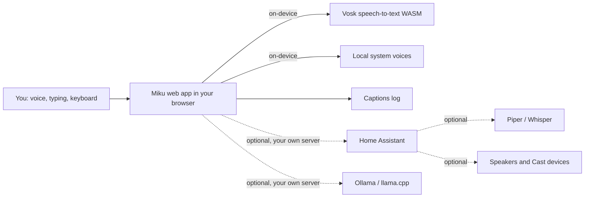

# Miku Home

[](LICENSE)
[](https://github.com/BowieMoonenTTV/miku-home/actions/workflows/a11y.yml)
[](#accessibility)
[](PRIVACY.md)

A free, open-source, **locally hosted** voice assistant called Miku. It is built first for a blind user with a speech impediment, so every feature has captions, a typed fallback and screen reader labels. Nothing you say or type is sent to us or to any cloud service.

By **BowieMoonen**. MIT licensed. No ads, no accounts, no paid tiers.

> Badges are images served by shields.io and GitHub when you view this README on GitHub. The app itself never loads them.

## Features

- **Works today with no server:** open the page, type or press **Speak**, and Miku answers with captions.
- **On-device speech input:** [Vosk](https://alphacephei.com/vosk/) runs in your browser through WebAssembly. Audio never leaves the device.
- **On-device spoken replies:** only voices that your system marks as local (`localService`) are used. If none exist, Miku uses captions only and tells you.
- **Captions for everything:** a caption log with times, plus repeat and clear buttons. Replies are announced to screen readers only when Miku's own voice is not speaking them, so you never hear a reply twice.
- **Screen reader mode:** the setting "Let my screen reader read replies" turns Miku's voice off so your screen reader (for example Orca, NVDA, VoiceOver or TalkBack) reads each reply instead. Not yet tested with a real screen reader.
- **Keyboard first:** Alt+Shift+S speak, Alt+Shift+T type, Alt+Shift+L last caption, Alt+Shift+R repeat, Escape stop.
- **Optional avatar:** a three.js face with TalkingHead lip-sync, or your own VRM. Off by default; it respects reduced motion.
- **Optional add-ons, auto-detected:** Home Assistant, Ollama or llama.cpp, Piper or Whisper servers, avatar packs. See [docs/addons](docs/addons/README.md).
- **Local error log:** view, copy or export it yourself. Nothing is reported anywhere.
- **Installable PWA:** works offline after the first load.

## Accessibility

Target: **WCAG 2.2 AA**. What we do:

- Skip link, visible 4px focus outline, forced-colours (high contrast) support.
- Touch targets of at least 48 by 48 pixels; the Speak button is much larger.
- Captions always visible in a log; replies announced through a polite live region only when Miku's voice is off or unavailable (no double speech); status messages in `role="status"`.
- The Speak button always has the name "Speak" and reports listening with `aria-pressed`.
- `prefers-reduced-motion` stops all avatar animation.
- Every voice action has a typed equivalent.
- Tested with axe-core, pa11y (HTML_CodeSniffer + axe) and html-validate on every push.
- Manual checks planned with VoiceOver (iOS), TalkBack (Android) and Orca plus braille (Linux). See [ROADMAP.md](ROADMAP.md) for the gates.

Automated tests cannot prove accessibility. Please [open an issue](https://github.com/BowieMoonenTTV/miku-home/issues/new/choose) if anything is hard to use.

## Quick start

Project status (current release, downloads, testing and store plans): <https://bowiemoonenttv.github.io/miku-home/status.html>

Use it in a browser: open <https://bowiemoonenttv.github.io/miku-home/>, or run it yourself:

```bash
npm ci
npm start          # http://127.0.0.1:8080
npm test           # html-validate, unit, end-to-end, axe, pa11y
```

The microphone only works on `https://` or `localhost`. To use it from your phone at home, serve it over HTTPS on your own network (for example `tailscale serve`), see [docs/mobile-pi-cmachine.md](docs/mobile-pi-cmachine.md).

On a **Steam Deck / SteamOS**: switch to Desktop Mode, open the site in a browser and install it, or add the browser as a non-Steam game with the site URL. Orca and braille on SteamOS are not update-safe because the system image is read-only and is replaced on update.

## Downloads

> **Warning: the Windows and macOS builds are unsigned.** Windows will show a SmartScreen warning ("Windows protected your PC") and macOS will show a Gatekeeper warning saying the app cannot be opened or is from an unidentified developer. This is expected for now. Only install them if you downloaded them from this repository's release page and the checksum matches `SHA256SUMS`. On Windows choose "More info", then "Run anyway". On macOS open System Settings, Privacy and Security, and choose "Open Anyway".

| Platform | Status |
| --- | --- |
| Web (PWA) | <https://bowiemoonenttv.github.io/miku-home/> (GitHub Pages). Mirror: <https://miku-home.vercel.app/> |
| Android APK | [v0.1.0-beta prerelease](https://github.com/BowieMoonenTTV/miku-home/releases/tag/v0.1.0-beta): signed, sideload. Not yet tested with TalkBack on a phone |
| Linux Flatpak | Bundle on the [release page](https://github.com/BowieMoonenTTV/miku-home/releases/tag/v0.1.0-beta). Not on Flathub |
| Linux .deb | On the [release page](https://github.com/BowieMoonenTTV/miku-home/releases/tag/v0.1.0-beta) |
| Windows | [Miku.Home_0.1.0-beta_x64-setup.exe](https://github.com/BowieMoonenTTV/miku-home/releases/download/v0.1.0-beta/Miku.Home_0.1.0-beta_x64-setup.exe). Built by CI, unsigned, not yet tried on a real PC; see [docs/signing.md](docs/signing.md) |
| macOS | [Miku.Home_0.1.0-beta_universal.dmg](https://github.com/BowieMoonenTTV/miku-home/releases/download/v0.1.0-beta/Miku.Home_0.1.0-beta_universal.dmg). Built by CI, unsigned, not yet tried on a real Mac |
| Linux AppImage | [Miku.Home_0.1.0-beta_amd64.AppImage](https://github.com/BowieMoonenTTV/miku-home/releases/download/v0.1.0-beta/Miku.Home_0.1.0-beta_amd64.AppImage). Built by CI, not yet tried on a real desktop |

Check downloads against `SHA256SUMS` on the release page.

See the [Installation wiki page](docs/wiki/Installation.md).

## Architecture



Everything solid runs on your device. Dotted lines are add-ons you host yourself; the strict Content Security Policy only allows the origins you configure.

## Privacy

No data leaves your device or your own server. No analytics, no CDNs, no remote fonts, no crash reporting. CI fails if the app makes a single request to another origin. Read [PRIVACY.md](PRIVACY.md).

## Support the project

Miku Home is free and stays free. If you want to help with hosting and signing costs, see [SUPPORT.md](SUPPORT.md). There are no perks, tiers or early access.

## Contributing

See [CONTRIBUTING.md](CONTRIBUTING.md), [CODE_OF_CONDUCT.md](CODE_OF_CONDUCT.md) and [SECURITY.md](SECURITY.md). Maintenance is described in [MAINTAINING.md](MAINTAINING.md).

## Credits

- [three.js](https://github.com/mrdoob/three.js) (MIT), [@pixiv/three-vrm](https://github.com/pixiv/three-vrm) (MIT)
- [TalkingHead](https://github.com/met4citizen/TalkingHead) lip-sync by Mika Suominen (MIT)
- [vosk-browser](https://github.com/ccoreilly/vosk-browser) (Apache-2.0) and the [Vosk](https://alphacephei.com/vosk/) small English model (Apache-2.0)
- [home-assistant-js-websocket](https://github.com/home-assistant/home-assistant-js-websocket) (Apache-2.0)
- [axe-core](https://github.com/dequelabs/axe-core) (MPL-2.0)

Full details: [THIRD_PARTY_NOTICES.md](THIRD_PARTY_NOTICES.md). Hatsune Miku is a character of Crypton Future Media; this project is fan-made, not affiliated, and ships no Miku model. See [docs/avatar.md](docs/avatar.md).
